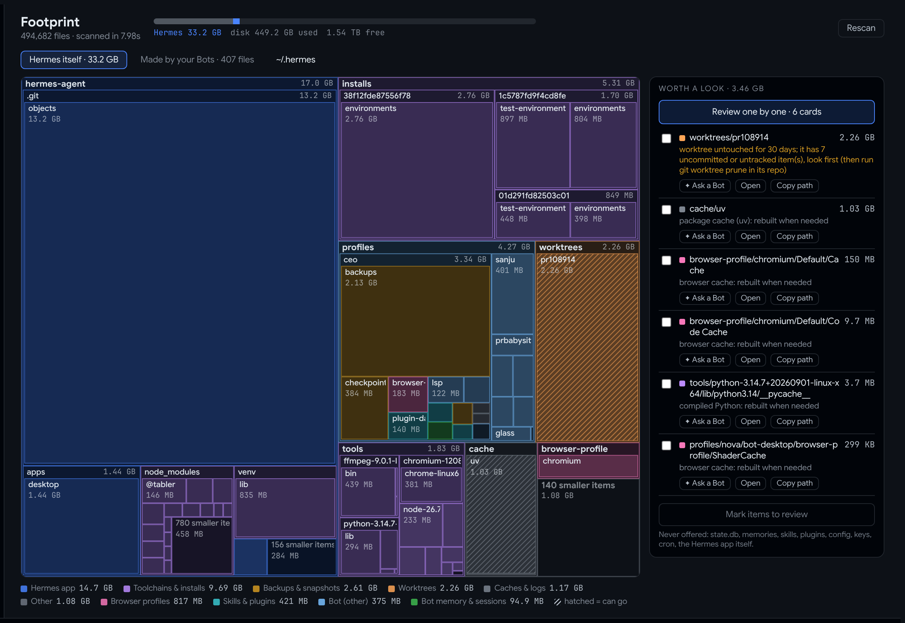
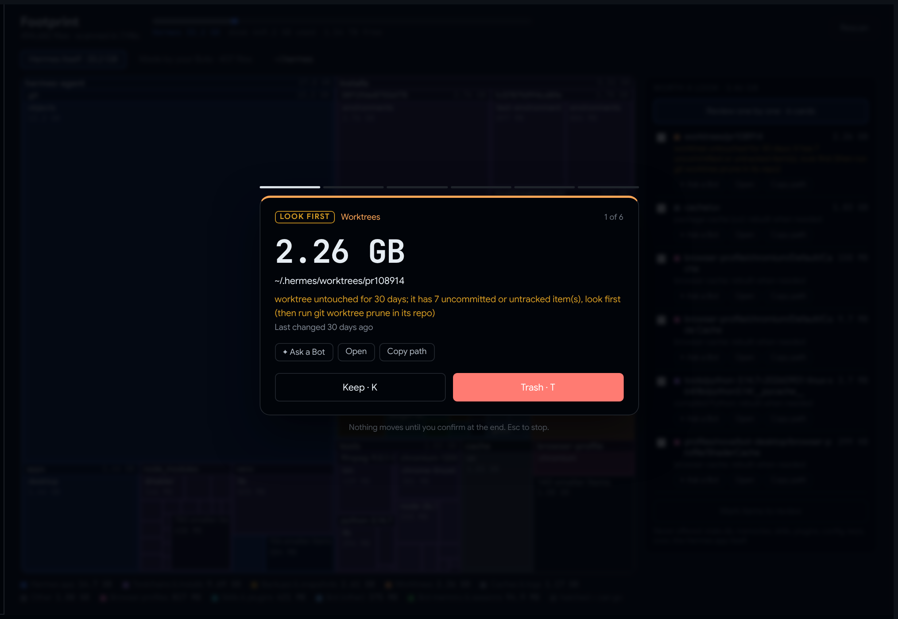
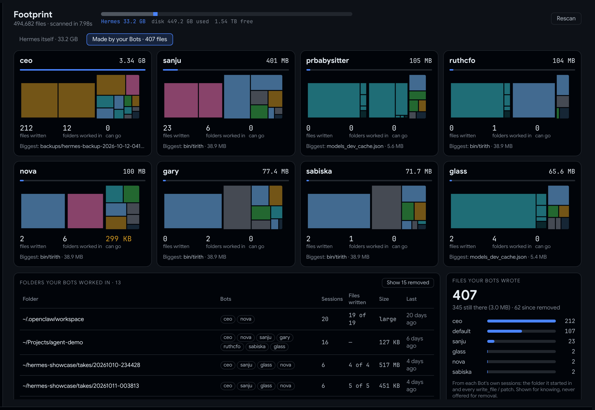

# Hermes Footprint

**How much of your disk is Hermes Agent, what is it, and what can go.** A page inside Hermes Desktop.



Inspired by Tobi Lütke's [disktree](https://github.com/tobi/disktree), built for the one folder a general disk tool can't read: `~/.hermes`. Footprint knows which folder is the Hermes app, a Bot's memory, a worktree, a backup, a browser profile, a language server or a package cache. It also knows what your Bots made outside it.

## What you get

**A treemap of `~/.hermes`.** It's coloured by what each folder is *to Hermes*. Click a folder to zoom in. Hatched tiles are space that can come back, and each one says why: "package cache (uv): rebuilt when needed", or "worktree untouched for 30 days; it has 7 untracked items, look first".

**A review deck.** Go through what can go one card at a time: **Keep** (K) or **Trash** (T). Each card shows the size, the reason and a badge: **SAFE** for rebuildable caches, **LOOK FIRST** for anything holding uncommitted work. Nothing moves until you confirm at the end. Anything you keep stays off the list.



**Bot cards.** Each Bot gets a card with a mini treemap of its own folder, the files it wrote, the folders it worked in and its biggest item. Below the cards is every folder your Bots worked in, from each session's own record, and every file they wrote with `write_file` / `patch`, still there or since removed.



**On every item:**
- **✦ Ask a Bot** drafts the question in chat ("what is this, is it safe to remove? look only"). It never sends the message.
- **Open** shows the folder in your file manager.
- **Copy path** copies the path.

**Also:**
- **Status-bar chip:** `▦ Hermes 33.2 GB · 3.46 GB can go`.
- **Commands:** `hermes footprint` in the terminal and `/footprint` in chat.

## Safe by design

- **Read-only scanning.** It counts allocated blocks (like `du`) and counts hardlinks once. It never crosses into another mounted disk.
- **Trash only.** It uses `gio trash` or `trash-put` and never deletes permanently. Nothing moves until you've reviewed the list and confirmed.
- **Re-checked before moving.** A fresh scan must mark that exact path again first; anything else is refused.
- **Never offered:** `state.db`, memories, skills, plugins, config, keys, `.env`, cron, the Hermes app itself, and the toolchains Hermes installs (language servers, runtimes). The Bots view is for knowing; nothing in it can be removed.
- **Open is limited** to folders inside `~/.hermes` or a folder a Bot worked in.
- **No message text** leaves the plugin: only paths, sizes, times and counts.

## Footprint and the built-in `disk-cleanup` plugin

Hermes ships a `disk-cleanup` plugin. It tracks temporary files your Bots create during a session and removes them automatically. Footprint is the other half:
- It shows everything in `~/.hermes`, not only what was tracked.
- It tells you what each folder is.
- It lets you choose, and it only moves to the Trash.

Run both.

## Install

```bash
hermes plugins install BkashJEE/hermes-footprint --enable
# then switch on its Desktop page in Hermes Desktop: Capabilities → Plugins
```

Restart Hermes Desktop if Footprint doesn't appear in the list.

## Tests

```bash
python3 tests/test_footprint.py
```

`harness/` renders the Desktop page in a browser with a mock SDK. Its Trash step is canned and never touches the disk. The README images are from that harness, using a real scan of the author's machine.

MIT licensed.
