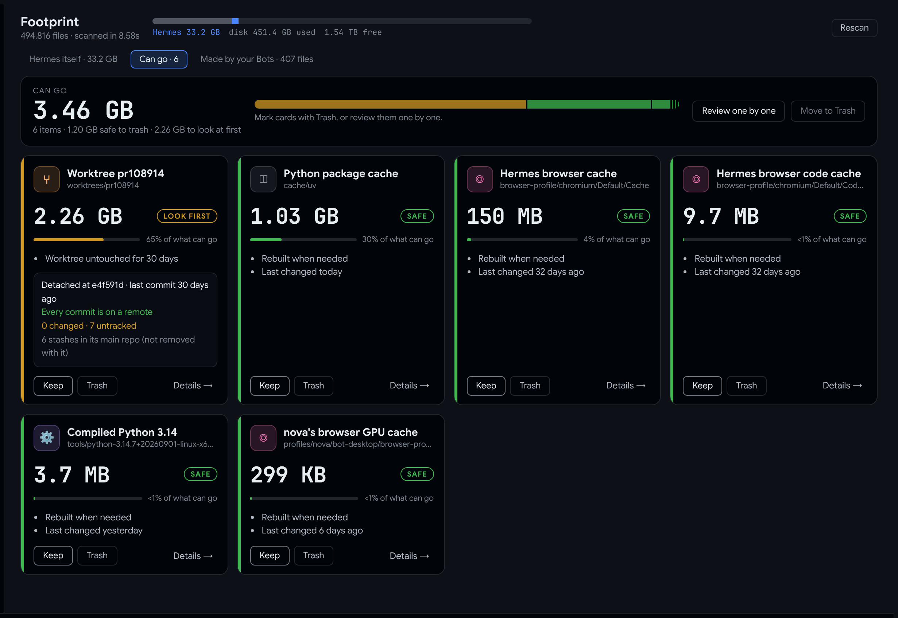

# Hermes Footprint

**How much of your disk is Hermes Agent, what is it, and what can go.** A page inside Hermes Desktop.



Tobi Lütke [wondered where his disk space went](https://x.com/tobi/status/2103251521223921739) and built [disktree](https://github.com/tobi/disktree). Footprint is the same idea for the one folder a general disk tool can't read: `~/.hermes`. It knows which folder is the Hermes app, a Bot's memory, a worktree, a backup, a browser profile, a language server or a package cache, and it knows what your Bots made outside it.

## What you get

**Can go.** Everything that could be cleared, as cards:
- **Each card:** the size, a plain name ("Python package cache", "Worktree pr108914"), why it can go, and a **SAFE** or **LOOK FIRST** badge.
- **Git-aware:** for a git checkout, what git knows (branch, changed and untracked files, commits that exist on no remote, stashes), so you never trash work that lives nowhere else.
- **Keep / Trash** right on the card, or **Review one by one** with K / T.

**Hermes itself.** A treemap of `~/.hermes`, coloured by what each folder is *to Hermes*:
- Click to zoom in.
- Hatched tiles are space that can come back.


**Made by your Bots.** A card per Bot with a mini treemap of its folder. Below the cards:
- every folder your Bots worked in, from each session's own record;
- every file they wrote with `write_file` / `patch`, still there or since removed.


**Review one by one.** One card at a time, Keep or Trash. Nothing moves until you confirm at the end.


**✦ Hand to a Bot.** Mark items and Footprint drafts the job for a Bot in Hermes chat. It's only a draft; nothing is sent. The draft:
- gives each item's exact path and reason, and the right way to remove it (`git worktree remove`, `uv cache clean --cache-dir <that folder>`, or the trash);
- tells the Bot to check each path first and stop if a checkout holds work that exists nowhere else;
- asks for a plan and your OK before anything moves.

**Also:**
- **On every item:** ✦ Ask a Bot (a draft question), Open in the file manager, Copy path.
- **While scanning:** a live progress bar with Stop.
- **Status-bar chip:** `▦ Hermes 33.2 GB · 3.46 GB can go`.
- **Commands:** `hermes footprint` in the terminal and `/footprint` in chat.

## Safe by design

- **Read-only scanning.** Allocated blocks (like `du`), hardlinks counted once, never crossing into another mounted disk.
- **Trash only.** It uses `gio trash` or `trash-put` and never deletes permanently. Nothing moves until you've reviewed the list and confirmed.
- **Re-checked before moving.** A fresh scan must mark that exact path again first; anything else is refused.
- **Never offered:** `state.db`, memories, skills, plugins, config, keys, `.env`, cron, the Hermes app itself, and the toolchains Hermes installs (language servers, runtimes). The Bots view is for knowing; nothing in it can be removed.
- **Open is limited** to folders inside `~/.hermes` or a folder a Bot worked in.
- **No message text** leaves the plugin: only paths, sizes, times and counts.
- **This machine only.** It always scans the computer it runs on, never a remote connection.

## Footprint and the built-in `disk-cleanup` plugin

Hermes ships a `disk-cleanup` plugin. It tracks temporary files your Bots create during a session and removes them automatically. Footprint is the other half:
- It shows everything in `~/.hermes`, not only what was tracked.
- It tells you what each folder is.
- It lets you choose, and it only moves to the Trash.

Run both.

## Install

```bash
hermes plugins install BkashJEE/hermes-footprint --enable
```

Then switch on its page in Hermes Desktop: **Capabilities → Plugins → Footprint**. Restart Desktop if it doesn't appear.

The plugin is enabled per profile. The page finds whichever local profile has it enabled.

## Development

```bash
python3 tests/test_footprint.py      # 10 tests on a fake ~/.hermes (no pytest needed)
python3 harness/make-payload.py      # scan this machine into harness/payload.js (git-ignored)
python3 -m http.server 4735          # then open http://127.0.0.1:4735/harness/index.html
scripts/make-images.sh               # rebuild docs/*.png and the social preview
```

`harness/` runs the real `desktop/plugin.js` against a mock of the Desktop plugin SDK. Its Trash step is canned and never touches the disk.

The images in this README come from that harness, using a real scan of the author's machine. `docs/social.html` is the source of the social preview.

MIT licensed.
